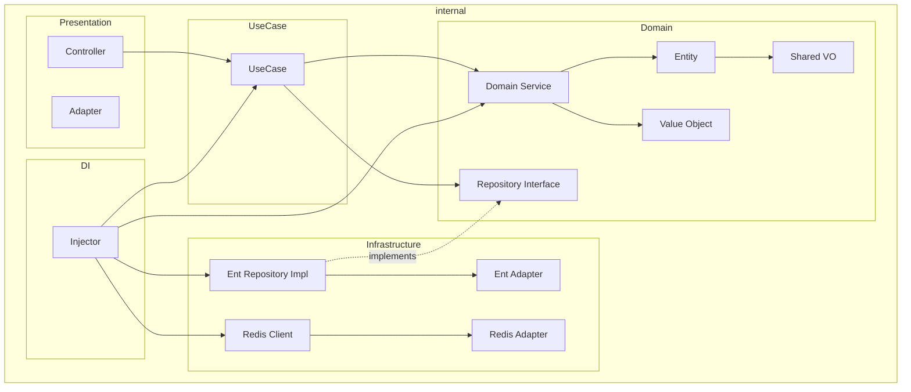
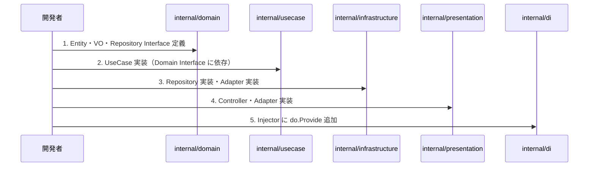
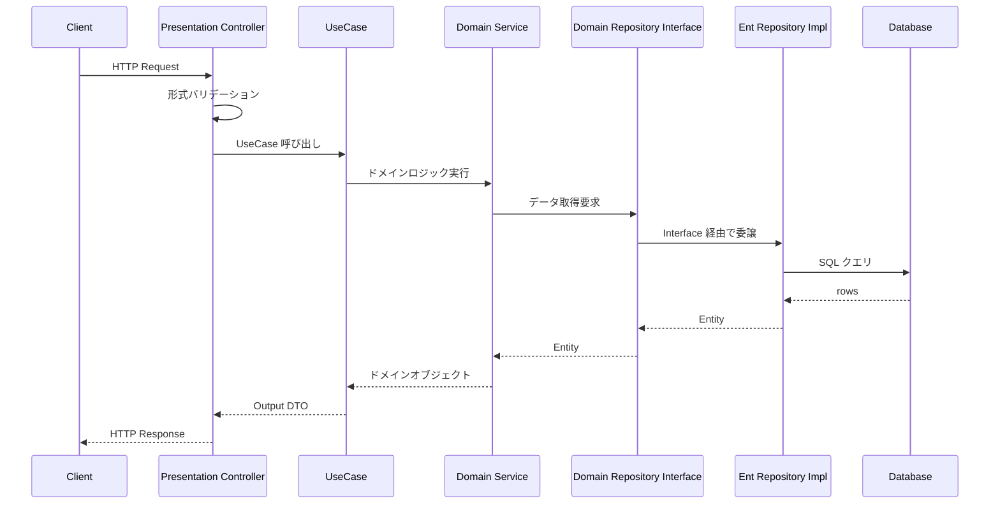
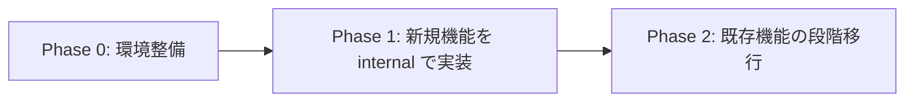

# Design Document: Clean Architecture + DDD Migration

## Overview

本設計は、既存のRepository Patternアーキテクチャを Clean Architecture + 軽量 DDD へ段階移行するための**環境整備フェーズ**を定義する。

まず feature-agnostic なスキャフォールド（`/internal/` ディレクトリ構成・共有コンポーネント・DI 統合）のみを整備し、次の機能開発から新アーキテクチャを使い始められる状態を目指す。

**ターゲットユーザー**: 開発者（機能実装時に新アーキテクチャの置き場と依存ルールを知る必要がある）

### Goals

- `internal/` 配下に Clean Architecture の 4 レイヤー構造を構築する
- feature-agnostic な共有コンポーネント（共有 VO・Redis クライアント・汎用レスポンス型）を整備する
- samber/do DI への統合パターンを確立する
- 新規機能開発者が迷わず実装を始められるドキュメント・規約を整備する

### Non-Goals

- 既存機能の一括移行（インクリメンタルに実施、本フェーズのスコープ外）
- 特定機能の実装（環境整備後に個別で実施）
- Logger・Transaction・DB インスタンス分離（別フェーズで対応）

### Design Principles

- **YAGNI**（You Aren't Going to Need It）: インターフェースや抽象化は必要になった時点で実装する。事前の過剰設計を避け、ファイル分割も必要になってから行う
- **Fail Fast**: VO のコンストラクタでバリデーションを行い、無効な値をその場で `error` として返す。後のランタイムエラーを防ぐ
- **UseCase ファイル分割タイミング**: 1 UseCase のメソッドが 4〜5 個を超えたら分割を検討し、10 個を超えたら必須とする

---

## Architecture

### Architecture Pattern & Boundary Map

依存方向は一方向（外側 → 内側）に限定し、内側は外側を知らない。



**依存方向ルール**:
- Presentation → UseCase → Domain（Domain は他を知らない）
- Infrastructure → Domain（インターフェースを実装するが依存は反転）

### パッケージ命名方針

| パッケージ | 命名 | 理由 |
|---|---|---|
| `entity/`, `repository/`, `service/` | フルネーム | それ自体が短い1単語であり省略不要 |
| ドメインモデル（共有・feature 固有ともに） | `model/` | VO に限定せず汎用的なドメインモデルを配置するため `model/` に命名。インポート時に `model.Date`, `model.UserID` と読みやすい |

> Go 公式スタイルガイドはパッケージ名を短く簡潔に保つことを推奨している。`strconv`, `bufio` など標準ライブラリも同様の方針を取る。

### Technology Stack

| Layer | Choice / Version | Role | Notes |
|-------|-----------------|------|-------|
| Domain | Go 標準ライブラリのみ | Entity・VO・Repository Interface 定義 | Gin/Ent インポート禁止 |
| UseCase | Go 標準ライブラリ + `github.com/pkg/errors` | ユースケース実装 | ドメイン層のインターフェースのみに依存 |
| Infrastructure | Ent v2, go-redis v8 | Repository 実装・外部サービス接続 | Adapter パターンで domain ↔ infra 変換 |
| Presentation | Gin | HTTP Controller・Adapter | 形式バリデーションのみ担当 |
| DI | samber/do | 軽量DIコンテナ（Generics活用） | — |

---

## System Flows

### 新機能追加時のフロー



### リクエスト処理フロー



---

## Components and Interfaces

### コンポーネント一覧

| Component | Layer | Intent | Key Dependencies |
|-----------|-------|--------|-----------------|
| SharedVO | Domain | 共有値オブジェクト（Date, URL, Pagination） | なし（標準ライブラリのみ） |
| DomainLayer | Domain | Entity・VO・Repository Interface のパターン | SharedVO |
| DomainService | Domain | 複数 Entity をまたぐビジネスロジック | DomainLayer |
| UseCase | UseCase | ユースケース実装 | DomainLayer, DomainService |
| EntRepository | Infrastructure | Ent による Repository 実装 | DomainLayer, EntAdapter |
| EntAdapter | Infrastructure | Ent Model ↔ Domain Entity 変換 | DomainLayer |
| RedisClient | Infrastructure | Redis 接続クライアント | go-redis |
| PresentationController | Presentation | HTTP リクエスト処理・形式バリデーション | UseCase |
| PresentationAdapter | Presentation | Domain Entity ↔ HTTP Response 変換 | DomainLayer |
| CommonResponse | Presentation | 汎用 HTTP レスポンス型 | — |
| DI Injector | DI | samber/do コンポーネント登録 | 全コンポーネント |

---

### Domain Layer

#### SharedVO（共有値オブジェクト）

**Responsibilities & Constraints**
- `internal/domain/model/` に配置
- 不変（フィールドは非公開、コンストラクタで生成）
- バリデーションを内包し、無効な状態を作れない設計

```go
// internal/domain/model/pagination.go
type PaginationParams struct {
    Page   int
    Limit  int
    Offset int
}
func NewPaginationParams(limit, page int) *PaginationParams

// internal/domain/model/date.go
type Date struct { /* 非公開フィールド */ }
func NewDate(t time.Time) Date
func (d Date) Value() time.Time

// internal/domain/model/url.go
type URL struct { /* 非公開フィールド */ }
func NewURL(raw string) (URL, error)
func (u URL) String() string
```

---

#### Entity・VO・Repository Interface パターン

- `internal/domain/{domain}/` 配下にフラット配置（サブディレクトリは作らない）
- **禁止**: `github.com/gin-gonic/gin`, `entgo.io/ent` のインポート
- Repository Interface の引数・戻り値はドメイン層の型のみ（インフラ層の型は禁止）

```go
// internal/domain/{domain}/{domain}_repository.go
type {Domain}Repository interface {
    List{Resource}ByType(params List{Resource}ByTypeParams) ([]*entity.{Resource}, error)
    Count{Resource}ByType(resourceType model.{ResourceType}) (int, error)
}

// コンパイル時検証（infrastructure 実装側に記述）
var _ repository.{Domain}Repository = &{domain}RepositoryEnt{}
```

golangci-lint の `depguard` ルールでドメイン層への Gin/Ent インポートを禁止することを推奨。

---

### UseCase Layer

- `internal/usecase/{domain}/` に配置
- ドメイン層の Repository Interface のみに依存（Ent 実装には依存しない）
- ビジネスレベルバリデーション（権限チェック、ドメインルール）を担当
- Input/Output DTO を定義し、Controller との境界を明確化

> **命名規則**: UseCase は Application 層に属し Domain 層ではないが、**「どのドメインを操作するか」を主語として命名する**。例: `User` ドメインを扱う UseCase → `UserUseCase`。

```go
// internal/usecase/{domain}/{domain}_use_case.go
type {Domain}UseCaseInterface interface {
    List{Resource}s(ctx context.Context, params model.PaginationParams, ...) ({Domain}Output, error)
}

type {Domain}UseCase struct {
    {Domain}Service service.{Domain}Service
}

func New{Domain}UseCase(svc service.{Domain}Service) {Domain}UseCase
```

---

### Infrastructure Layer

#### EntAdapter（変換アダプターパターン）

```go
// internal/infrastructure/ent/adapter/adapter.go
type {Domain}EntAdapter struct {}

// Domain Entity → Ent Model
func (a *{Domain}EntAdapter) ToModel(entity *entity.{Resource}) *ent.{Resource}

// Ent Model → Domain Entity
func (a *{Domain}EntAdapter) ToDomain(model *ent.{Resource}) (*entity.{Resource}, error)
```

---

### Presentation Layer

#### CommonResponse

```go
// internal/presentation/http/common/response.go
type ResponseMessage struct {
    Result bool         `json:"result"`
    Error  ErrorMessage `json:"error,omitempty"`
}

type GetListResponse[T any] struct {
    Result bool `json:"result"`
    Total  int  `json:"total"`
    Data   []T  `json:"data"`
}

type ErrorMessage struct {
    Code    string `json:"code,omitempty"`
    Message string `json:"message"`
    Details any    `json:"details,omitempty"`
}
```

---

### DI Layer

#### Injector

```go
// internal/infrastructure/di/injector.go
package di

import "github.com/samber/do"

func NewInjector() *do.Injector {
    injector := do.New()
    do.Provide(injector, todorepo.NewTodoRepository)
    do.Provide(injector, todoapp.NewCreateTodoUseCase)
    do.Provide(injector, todohandler.NewTodoServiceHandler)
    return injector
}
```

---

## Data Models

### Domain Model パターン

**Entity（同一性で識別）**
- ID フィールドを持つ（型安全な ID 型として ValueObject で定義）
- 可変だが、ドメインルールに従った状態変更メソッドを通じてのみ変更可能

**Value Object（値等価性）**
- 不変（コンストラクタ以外での変更不可）
- `==` または独自の `Equal()` メソッドで比較
- バリデーションをコンストラクタに内包

**Domain Service（stateless）**
- 複数 Entity をまたぐビジネスロジックを担当
- フィールドを持たない（または設定のみ）

```
internal/domain/{domain}/
├── {domain}_{resource}.go              # Entity, Value Object
├── {domain}_{resource}_repository.go   # Repository Interface
└── {domain}_service.go                 # Domain Service Interface + 実装
```

### Infrastructure Data Model

**Ent Schema**（`internal/infrastructure/ent/schema/`）:
- Ent のスキーマ定義からコード生成される型安全なモデル
- Domain Entity とは分離し、Adapter で相互変換

**Redis Cache Model**（`internal/infrastructure/redis/`）:
- JSON シリアライズ用の構造体
- TTL・キー設計を Adapter に集約

---

## Error Handling

### Error Strategy

| 層 | エラー種別 | 処理方針 |
|----|-----------|---------|
| Domain | バリデーションエラー（無効な VO 等） | `errors.New(...)` または `fmt.Errorf(...)` で返す |
| UseCase | ビジネスルール違反 | sentinel error（`var ErrXxx = errors.New(...)`）で定義 |
| Infrastructure | DB エラー・外部サービスエラー | エラーをラップして UseCase に伝播 |
| Presentation | 形式エラー | Gin の `c.JSON(http.StatusBadRequest, ...)` |

### Error Categories and Responses

- **4xx（形式エラー）**: Presentation Controller で検出、`common.ResponseMessage` で返す
- **4xx（ビジネスルール）**: UseCase の sentinel error を Controller でハンドリング
- **5xx（インフラ障害）**: ログ記録後、汎用 500 レスポンスを返す

### Monitoring

- uber-go/zap による構造化ログ
- エラーには `errors.Wrap` でスタックトレースを付与（`github.com/pkg/errors`）

---

## Testing Strategy

### Unit Tests（Domain 層）

- テスト対象: Entity・VO・Domain Service
- モック不要（インフラ依存なし）
- AAA パターン（Arrange / Act / Assert）を遵守

```
internal/domain/model/date_test.go
internal/domain/model/url_test.go
internal/domain/model/pagination_test.go
internal/domain/{domain}/*_test.go
```

### Unit Tests（UseCase 層）

- テスト対象: UseCase の各メソッド
- gomock でリポジトリインターフェースをモック化
- テーブル駆動テストで正常系・異常系を網羅

### Integration Tests

- 実 DB・Redis を使用する Repository 実装テスト
- testfixtures で初期データ投入

### CI ワークフロー

テストはDB依存の有無でワークフローを分離する。

| ワークフロー | 対象 | DB | カバレッジ閾値 |
|---|---|---|---|
| Domain Test | `internal/domain/...`, `internal/usecase/...` | 不要 | 90% |
| Integration Test | `internal/infrastructure/...` | 必要 | — |

- Domain/UseCase 層はインフラ依存がないため、DB起動なしで高速に実行される
- Infrastructure 層（Ent Repository等）はDB接続が必要

---

## Migration Strategy

### フェーズ定義



**Phase 0（環境整備）**

| 作業 | ファイル |
|------|---------|
| ディレクトリ構造作成 | `internal/` |
| 共有ドメインモデル追加 | `internal/domain/model/` |
| 汎用レスポンス型追加 | `internal/presentation/http/common/response.go` |
| DI Injector 登録 | `internal/infrastructure/di/injector.go` |

**Phase 1**: 新規機能を `internal/` で実装し、Injector に登録

**Phase 2**: 既存機能を修正時にボーイスカウトルールで段階的に移行

### ロールバック方針

- DI Injector から `do.Provide` を除去することで影響を局所化可能
- Phase 0 のファイルは独立しており、既存コードへの影響は最小限
