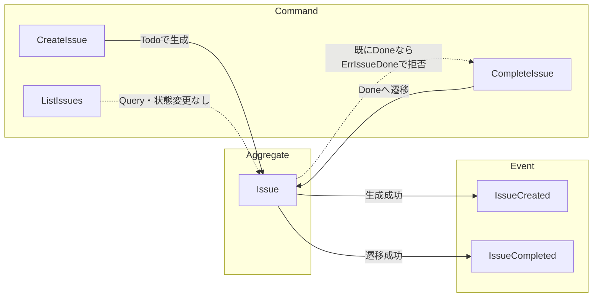
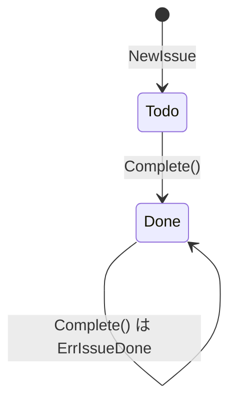
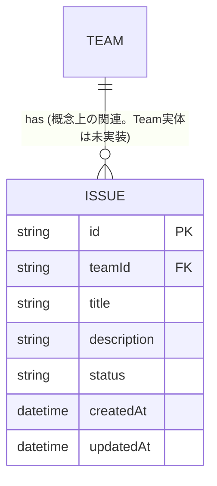

# linear ドメイン モデリング設計ドキュメント

`internal/domain/linear` の実装（`issue.go`, `issue_repository.go`）を根拠として、Issueドメインのモデリング内容を整理したドキュメントです。

## ユビキタス言語

| 用語 | 定義 |
|---|---|
| Issue | チーム（Team）に紐づく作業単位を表すEntity。生成時は`Todo`、`Complete`操作により`Done`へ遷移するライフサイクルを持つ |
| Team | Issueの帰属先。このボイラープレートでは`TeamID`（Value Object）としてのみ参照され、Team自体のEntity/Repositoryは未実装（集約境界の外側） |
| IssueID | Issueを一意に識別するVO。空文字は不正（`ErrEmptyIssueID`） |
| TeamID | Teamを一意に識別するVO。空文字は不正（`ErrEmptyTeamID`） |
| IssueStatus | Issueの状態を表す列挙値。`Todo` / `Done` の2値 |
| Complete | IssueをTodoからDoneへ遷移させるドメイン操作。既にDoneの場合は`ErrIssueDone`を返し状態遷移を拒否する |

## 集約・境界の整理

- **Aggregate Root**: `Issue`
- **集約内の構成要素**
  - `IssueID`（VO・識別子）
  - `TeamID`（VO・外部集約への参照。Teamの内部状態は保持しない）
  - `title` / `description`（プリミティブ、生成時にトリム・バリデーション）
  - `IssueStatus`（VO/Enum）
  - `createdAt` / `updatedAt`（監査用タイムスタンプ）
- **集約境界外**
  - `Team`: 現状はIDのみで疎結合に参照。Team自体の不変条件やライフサイクルはこのボイラープレートの対象外
- **Repository**: `IssueRepository`（`Save` / `FindByID` / `ListByTeam`）。集約単位（Issue単位）でのみ永続化操作を提供し、Team側の集約には踏み込まない

## 不変条件

| 不変条件 | 保証する場所 |
|---|---|
| `IssueID` / `TeamID` は空文字不可 | `NewIssueID` / `NewTeamID`（コンストラクタでFail Fast） |
| `title` は空文字（トリム後）不可 | `NewIssue` / `RestoreIssue` |
| 新規生成されたIssueは必ず`IssueStatusTodo`から開始する | `NewIssue` |
| 既に`Done`のIssueは再度`Complete`できない | `Issue.Complete`（`ErrIssueDone`） |

## 業務フロー（イベントストーミング）

Command → Aggregate → Event の対応関係。現状の実装にドメインイベント発行機構はないため、将来イベント駆動化する場合の対応関係を示すモデリング資料として記載する。

Issueのライフサイクル（状態遷移）:

## ER図・関連図

## 関連ドキュメント

- [DDD / Clean Architecture 設計ガイド](./knowledge-ddd-architecture.md) — 依存方向ルール、命名規約、レイヤー別責務
- [`internal` README](../internal/README.md) — linearドメインの実装ガイド
